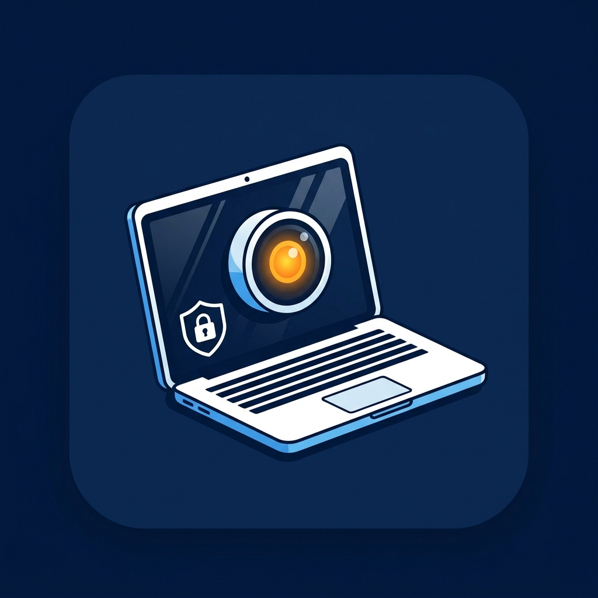
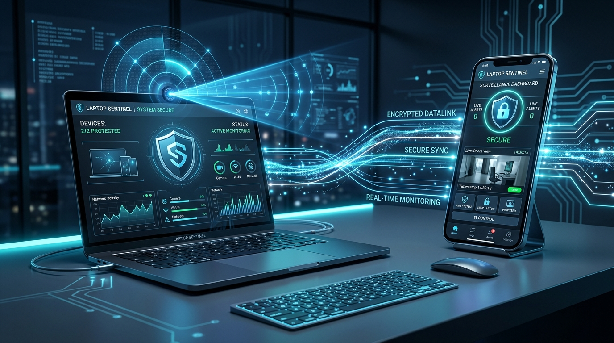
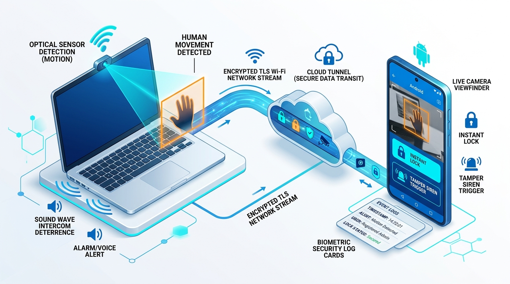
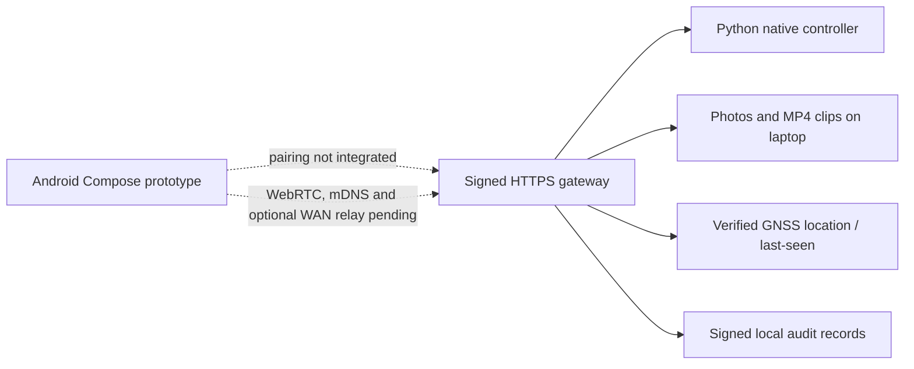
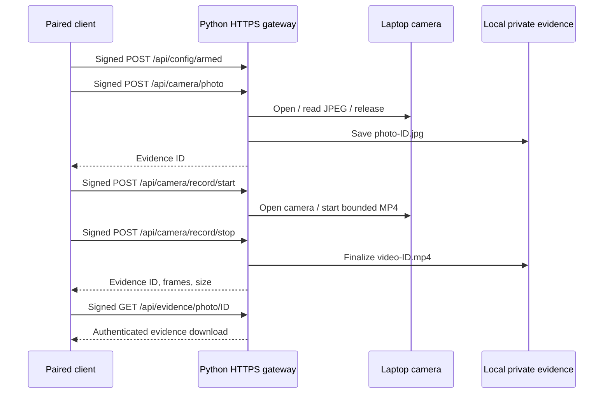
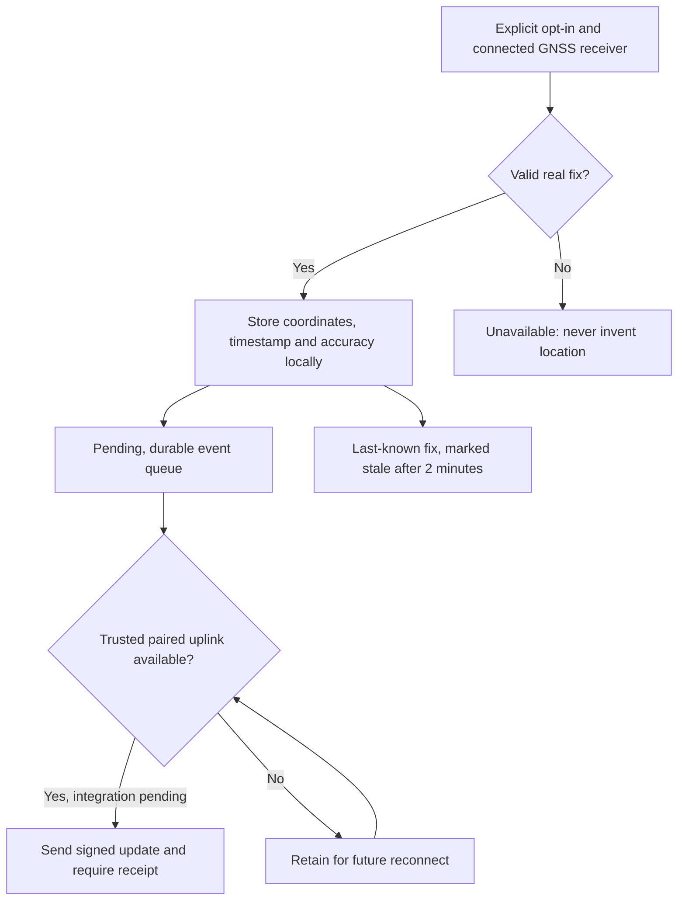

<div align="center">



# LaptopWatch

**Remote workstation vigilance · Private evidence capture · Anti-theft response**

Android controller + desktop companion — **under active development, not a production release**



</div>

> [!WARNING]
> **Not production-ready.** The existing Android app cannot yet pair with the new signed HTTPS gateway. Never expose the insecure, PIN-based legacy companion on a public network. This is an engineering repository, not a signed installable consumer product.

## What LaptopWatch is

LaptopWatch is intended to help the owner protect a laptop when they briefly step away at a café, library, office or campus. A visible camera can monitor a user-owned workstation; the paired owner should be able to review the feed, take photos, record a clip, trigger an alarm, lock the screen and inspect the last verified location. These features require the relevant hardware, OS permissions, power and connectivity; no app prevents physical theft.

### The café / restroom use case

You are working at a café and need to go to the restroom. You **lock the laptop**, leave it open and plugged in where permitted, arm LaptopWatch with a paired phone, and step away. The intended flow is: person approaches → on-device person detection → owner alert → owner opens a live view and can save a photo or video → owner may sound an alarm and call for help. Recording bystanders requires lawful notice and consent. A closed lid can physically block the webcam; suspension disables ordinary camera processing. **This complete Android-to-desktop flow is a target, not yet working end-to-end.** See [the detailed café/restroom and theft scenarios](docs/SCENARIOS.md).

## Project imagery and architecture



**The original imagery is retained** in `docs/images/`: `hero_banner.jpg`, `arch_overview.jpg`, and `app_icon.jpg`.



## What is implemented and what remains

| Capability | Implementation today | Production gap |
|---|---|---|
| Android interface | Kotlin, Compose, Room, six screens, demo and legacy setup | Native paired-key control, QR onboarding, end-to-end tests |
| Laptop control | Signed Python gateway: status, arm/disarm, lock and alarm | OS-specific device verification, desktop UI and installs |
| **Take a photo** | Signed `POST /api/camera/photo` writes private JPEG | Android controls, actual camera tests, retention and export UX |
| **Record video** | Signed `POST /api/camera/record/start` and `stop`; bounded local MP4 | Android integration, hardware codecs, durability/soak and quality tuning |
| View/download evidence | Signed `GET /api/evidence/{kind}/{id}` | In-app evidence vault and secure retention/deletion |
| Live camera | On-demand still snapshot fallback | Real WebRTC video, ICE reconnect, end-to-end latency |
| Motion alerts | Legacy OpenCV frame difference | Person-only on-device model, notification/push reliability |
| Authentication | Per-phone Ed25519 signatures, nonce/replay denial, paired registry in Python | Phone-side key management/QR, cert pinning and mobile integration |
| **Real location** | Opt-in `gpsd` GNSS provider, rejects missing/invalid fixes | Native Windows/macOS providers, receiver hardware and privacy consent UI |
| **Last-seen location** | Durable local SQLite timestamp, accuracy, stale/fresh flag | Trusted remote persistence accessible if the laptop is stolen |
| Offline reconnect queue | Holds unsent GNSS fixes until acknowledged by a trusted sender | Implement the signed remote sender, recipient and wake/reconnect hooks |
| Work while asleep/offline | Last known record survives on storage | Ordinary app code cannot run in deep sleep/power-off; see OS recovery |
| Desktop app | Python gateway and CLI modules | Tauri 2 + React/JSX, tray, autostart, signing and installers |
| Commercial release | Draft privacy, pricing, EULA and Play listing | Owner review, real accounts, payment, signed binaries, device matrix |

## Evidence capture workflow

The **development Python HTTPS gateway** offers signed, authenticated operations. Every request must be signed using the enrolled phone/device's private key, TLS certificate pinning is mandatory for remote use, and **no credentials go in URLs**.



**Available routes**: `GET /api/status`; `POST /api/lock`; `POST /api/alarm`; `POST /api/config/armed`; `GET /api/camera/frame`; `POST /api/camera/photo`; `POST /api/camera/record/start`; `POST /api/camera/record/stop`; `GET /api/evidence/photo/{id}`; `GET /api/evidence/video/{id}`; `GET /api/location/last-seen`; `POST /api/location/refresh`. Photo/video files live under the configured state directory's `evidence/` folder. No audio recording is provided by this new recorder; it saves webcam video without sound.

**Photo and record actions are implemented in the desktop Python gateway, not yet accessible from a correctly paired Android UI.** Camera access needs explicit arming, ownership and legal consent.

## Location, sleep, loss and connectivity



- **Location accuracy** comes from real receiver-reported uncertainty. Ordinary laptops seldom have dedicated GNSS/GPS receivers. Optional `gpsd` support works only with a configured receiver while the app is running; Wi-Fi or IP estimates are not meter-accurate GPS.
- **Offline** means no new remote report is delivered. Fixes already stored locally survive app restart; the phone only knows the **last location previously delivered to it or a trusted remote service**. An offline queue on a stolen laptop is not, by itself, a remote tracking service.
- **After reconnection** a tested queue hook can send unacknowledged fixes when a future paired end-to-end encrypted remote channel is available. The sender/service is still missing, so no instant reconnect alert is claimed.
- **Sleep, shutdown or dead battery:** user-mode Python cannot guarantee tracking, networking, or webcam operation. Supported macOS Find My hardware/network functionality may locate an offline sleeping Mac; Windows Find My Device should be enabled separately on Windows. A discrete cellular GPS tracker with its own battery is needed for tracking independent of laptop power/network.

Detailed feasibility, architecture and limitations: [Location, Lost Device & Reconnection Design](docs/LOCATION_AND_RECOVERY.md).

## Development quickstart

### Python development gateway

Requires Python 3.11+ and a developer workstation. This is **not** a one-click consumer installer.

```bash
cd desktop/src-python
python -m venv .venv
# activate the virtual environment for your platform
python -m pip install -e '.[test,media]'
python -m pytest -q
python -m laptopwatch.cli --state-dir ./local-dev init
```

Generate an Ed25519 phone/device keypair in a secure client, then approve pairing at the **desktop itself**:

```bash
python -m laptopwatch.cli --state-dir ./local-dev pair --device-id UUID --public-key-b64url PHONE_PUBLIC_KEY
python -m laptopwatch.cli --state-dir ./local-dev serve --port 8765
```

The second command starts a signed HTTPS gateway on localhost. `--listen-lan` is an explicit, development-only remote opt-in that **requires** local pairing first; the connecting client must pin the certificate fingerprint and sign requests. The existing Android app does not yet implement this protocol. Enable real receiver polling only with user consent:

```bash
python -m laptopwatch.cli --state-dir ./local-dev serve --enable-gpsd
```

The tracker samples the locally configured `gpsd` receiver about every 30 seconds while awake. No receiver/permission means no fix. The last-seen history is stored in `local-dev/last_seen.db` and evidence in `local-dev/evidence/`. Keep this directory outside version control and protect the disk with OS full-disk encryption.

### Android prototype

Open the `app/` module in Android Studio with compatible SDK/build tools. The repository does not yet have a complete tested Gradle wrapper, device test matrix, release-signing assets or secure phone pairing. Use demo mode only for UI preview. **Do not connect the older HTTP/PIN companion to an untrusted network.**

### Verification

```bash
cd desktop/src-python
python -m pytest -q
# Android build, lint and real device tests remain release gates
```

Thirteen tests were executed locally for the newly added evidence and tracking modules; they use mocks, not physical devices. Existing security/gateway unit suites and Android build/connected-device gates require a full reproducible run before release. See [test matrix](docs/TEST_MATRIX.md) and [performance evidence](docs/PERFORMANCE.md).

## Key repository directories

| Directory | Contents |
|---|---|
| `app/` | Android Compose UI, legacy client and Room database |
| `desktop/src-python/laptopwatch/` | Paired HTTPS gateway, OS controller, evidence, tracking, audit and identity |
| `desktop/src-python/tests/` | Python unit/integration test sources |
| `docs/images/` | Original hero banner, architecture artwork and app emblem |
| `docs/SCENARIOS.md` | Café, restroom, theft and offline usage narratives |
| `docs/LOCATION_AND_RECOVERY.md` | Accurate GNSS, offline queues and sleep-mode capability boundaries |
| `docs/ARCHITECTURE.md` | Target ADRs and release branching policy |
| `docs/DEFECTS.md`, `docs/RELEASE_CHECKLIST.md` | Outstanding security/quality gates |
| `docs/commercial/` | Draft legal/storefront copy, **not** approved policies |

## Git workflow and production release

Only `perez` (development) and `main` (integration/release). Make coherent commits on `perez`; run milestone builds, tests and security checks; merge via a normal **non-fast-forward PR** to `main` after verification; fast-forward `perez` to the merge commit to keep both branch tips synchronized. Do not create feature branches or silently add GitHub Actions workflows.

Release phases remain: verified audit/security → paired WebRTC/discovery → Tauri desktop → person classifier → signed packages → UX/accessibility → measured soak → legally approved commercial launch. **A green Python unit suite is not a production-ready Android/desktop release.**

## Security, privacy and license

Only monitor devices you own or are authorized to monitor; give the legally required notice and consent to everyone who may be recorded. Do not operate the camera covertly. Existing legacy default PIN/HTTP behavior is unsuitable for production. Use full-disk encryption and an OS password. No production-grade remote location relay, OS-backed private-key storage, licensing server or published privacy policy exists yet.

[Security threat model](docs/THREAT_MODEL.md) · [Release checklist](docs/RELEASE_CHECKLIST.md) · [Draft privacy policy](docs/commercial/PRIVACY.md) · [Draft EULA](docs/commercial/EULA.md).

**License notice:** The source has no owner-approved `LICENSE` file; do not assume the former README's MIT claim grants redistribution rights. The rights holder must approve a commercial or open-source license before publishing installers.
