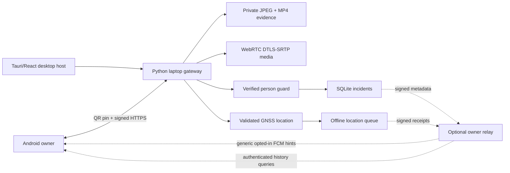

<div align="center">


# LaptopWatch

**Remote workstation vigilance · Private evidence capture · Anti-theft response**

Android controller + Tauri desktop companion — **0.3.0-dev, not a production release**


</div>

> [!WARNING]
> **Not production-ready.** The signed Android/desktop pairing implementation is present in source but is not yet verified on real devices or distributable as a signed release. Never expose the insecure, PIN-based legacy companion on a public network. This is an engineering repository, not a signed installable consumer product.

## Technology stack

| Layer | Technologies | Purpose |
|---|---|---|
| Android UI | Kotlin, Jetpack Compose, Material 3, Lifecycle/Coroutines | Owner controls, device pairing, dashboards and consent |
| Mobile persistence | Android Room, SQLite, Android Keystore AES-GCM | History, device identity and encrypted phone signing key |
| Mobile networking | OkHttp, Bouncy Castle Ed25519, signed HTTPS/TLS fingerprint, Android NsdManager, Google Code Scanner | QR-based authorized device pairing and trusted LAN discovery |
| Mobile media | GetStream WebRTC for Android, Coil, Android microphone permissions | DTLS-SRTP live video, opt-in two-way audio and evidence preview |
| Mobile notifications | Android notifications, Firebase Cloud Messaging, AndroidX WorkManager | Optional background event hints and retryable signed token enrollment |
| Desktop frontend | React 19, Vite 7, QRCodeSVG, Tauri 2 | Native owner dashboard, QR, tray, trusted devices, evidence and settings |
| Native desktop | Rust, Tauri shell/autostart, rusqlite | Restricted native controls, sidecar lifecycle and direct read-only status |
| Gateway/backend | Python 3.11+, FastAPI, Uvicorn, Pydantic | Authenticated local REST API and OS laptop actions |
| Security | Ed25519, SHA-256, replay-resistant nonces, cryptography, AES-256-GCM | Signed commands, integrity, local identity and encrypted relay records |
| Camera/detection | OpenCV, NumPy, YOLOX Nano ONNX (optional externally supplied/pinned), PyAV, aiortc, sounddevice | Person confirmation, visible JPEG/MP4 recording and encrypted media |
| Recovery/network | gpsd with genuine GNSS, SQLite offline queues, mDNS/Zeroconf, ICE/STUN/TURN options | Last verified location and authenticated reconnect delivery |
| Optional self-hosted relay | Python/FastAPI, Docker Compose, Caddy HTTPS, SQLite AES-GCM, Google Auth/FCM HTTP v1 | Owner-provisioned location and incident receipt/push service |
| Packaging/testing | PyInstaller, Tauri native bundler, Gradle, Android SDK, Pytest, Robolectric, instrumentation tests | Source test harnesses, builds and eventual signed installers |

**Platforms:** Android controller and Windows/macOS/Linux desktop source.
There is **no iOS client** in this repository. Optional relay hosting and
Firebase services require separate owner-provisioned accounts.

## What LaptopWatch is

LaptopWatch pairs an Android owner device with a user-owned laptop for visible,
permission-based anti-theft monitoring. The signed local gateway can arm and
disarm the camera, lock the operating system, sound an alarm, speak a warning,
capture JPEG images, record bounded MP4 clips and negotiate WebRTC video and
optional phone microphone audio.

A SHA-256 verified external ONNX person model is required for person-triggered
incidents. With it and explicit arming, motion is only a prefilter; a verified
person can create an incident and optional local photo/video. Signed Android
foreground polling retrieves events and evidence. Optional remote push sends
generic FCM hints only; an owner-controlled relay and verification are necessary.

### Café/restroom example

Lock your laptop, leave the camera visible where lawful, arm from the paired
phone and step away. A configured model can detect a person, save bounded
local evidence and log an event. Your phone can view the signed incident log,
start encrypted video, download media or sound an alarm while the laptop is
awake and reachable. If you configured remote FCM alerts, a signed incident
event may trigger a generic notification that asks you to open the app and
verify it. **Field reliability and legal consent must be validated first.**

See [usage and emergency scenarios](docs/SCENARIOS.md).

## Architecture and original artwork


The existing artwork remains in `docs/images/`: `app_icon.jpg`,
`hero_banner.jpg` and `arch_overview.jpg`.



The remote paths require real DNS/TLS, provider accounts, enrolled device
public keys and operating infrastructure. The laptop must be awake and
running; no software guarantees camera/GNSS activity in deep sleep or
power-off.

## Implementation and release gates

| Feature | Source implementation | Still requires |
|---|---|---|
| QR pairing and security | Signed invites, per-phone Ed25519 key, TLS fingerprint verification, local approval/revocation, signed API and replay denial | Real phone pairing, cross-OS TLS and security testing |
| Photos/recordings | Armed JPEG and bounded MP4 with authenticated download and desktop evidence folder | Webcam, codecs, clean stop/retention tests |
| Live video and intercom | aiortc signaling/stream and Android WebRTC receiver/opt-in audio | Physical phones, ICE/TURN, WAN changes, microphone tests |
| Person-triggered alerts | Optional model hash check, camera guard, motion/person confirmation, verified incident API, local auto-JPEG/MP4 and signed phone sync | Licensed model weights, false-positive trials, thermal soak |
| Remote push | Signed incident uploader, encrypted owner relay, FCM adapter, Android opt-in registration and foreground validation | Deployed relay, Firebase credentials, actual notification/wake tests |
| Last-seen location | Genuine opt-in gpsd fixes, durable local queue, signed receipts, AES-GCM encrypted self-hosted remote record, phone queries | Working receiver, DNS, backups and Internet-outage tests |
| Desktop distribution | React/Tauri tray, settings, Python sidecar, per-target bundler inputs | Native OS builds, verified lockfiles, code signing, notarization |
| Commercial sale | Draft privacy/EULA/data safety/pricing, installation instructions and source architecture | Owner-approved license, rights review, merchant, customer support and signed installers |

Source-level implementation is **not** a verified installation. The complete
integrated Android, Python, Rust, React and relay suite has not passed on actual
devices. An external person model is not bundled. Apple/Windows OS geolocation
providers beyond `gpsd` are not implemented. The legacy HTTP/PIN transport
has been disabled; no PINs are sent in URLs.

## Location, offline continuity and limitations

Real receiver-reported uncertainty is shown rather than invented GPS
precision. A saved last-seen fix is **historical even if recent**. Records
persist while the laptop is offline; reports are sent to the opt-in HTTPS
relay when connectivity returns and a signed receipt matches. A tiny
connection window may not permit a complete HTTPS transmission.

Deep sleep, power-off, dead battery or a physically blocked webcam prevent
ordinary software tracking and recording. Enable legitimate OS Find My
features or install independently powered GNSS/cellular hardware if
power-independent recovery is needed. No computer software can guarantee
theft prevention. [Recovery limits](docs/LOCATION_AND_RECOVERY.md).

## Build and test prerequisites

**Desktop Python** (development): install Python 3.11+, then:

```bash
python -m pip install -e 'desktop/src-python[test,media,discovery]'
cd desktop/src-python
python -m pytest -q
```

**Tauri desktop**: Node 22+, Rust/Tauri 2 OS prerequisites, Python,
PyInstaller and Pillow:

```bash
python -m pip install pyinstaller pillow
python desktop/scripts/prepare_sidecar.py
cd desktop
npm install
npm run tauri dev
```

**Android**: Android Studio, JDK 17+, Android SDK 36.1 and Gradle 9.3.1.
The repository contains distribution properties but lacks the verified
Gradle wrapper JAR/launchers. Obtain them from the official Gradle
distribution and verify official checksums before committing. Native
Android and desktop builds are unverified.

**Optional relay**: Docker Compose and Caddy, owner domain, TLS, device
public-key enrollment, opt-in GNSS/push and provider credentials. Do not
upload secrets or test personally identifying data to Git.

Full [build/run/install/acceptance guide](docs/BUILD_AND_RELEASE.md),
[desktop instructions](desktop/README.md) and
[optional relay setup](services/location-relay/README.md).

## Repository layout

| Location | Contents |
|---|---|
| `app/` | Android Compose UI, Room, signed HTTPS, WebRTC, optional FCM |
| `desktop/src-ui/` | React/Vite desktop owner dashboard |
| `desktop/src-tauri/` | Rust/Tauri shell, tray and restricted native operations |
| `desktop/src-python/` | Secure Python controller, camera guard, GNSS and tests |
| `services/location-relay/` | Optional encrypted single-owner metadata relay |
| `docs/images/` | Existing logo, hero image and architecture artwork |
| `docs/SCENARIOS.md` | Café/restroom, privacy and theft workflows |
| `docs/BUILD_AND_RELEASE.md`, `docs/STATUS.md` | Gates and reproducibility |
| `docs/commercial/` | Draft EULA, privacy, data safety, website and pricing |

## Git workflow

Exactly two active branches: `perez` for development and `main` for
integration. Commit coherent work to `perez`, verify source, open a normal
PR and merge to `main`. Fast-forward `perez` to the merge commit so both
tips are identical. No GitHub Actions or extra branches. A main merge is
**not** proof of release safety and does not authorize a versioned tag.

## Legal, security and distribution

Only monitor a laptop you own or have permission to control. Give legally
required notice and obtain recording consent; never record covertly.
Evidence, audit, precise location and push tokens are personal data. Apply
data retention, access restrictions, backups and OS disk encryption.
The desktop identity still uses protected local key files rather than
fully integrated Windows CNG/macOS Keychain/Linux Secret Service storage.

**Commercial status:** No approved source `LICENSE`, production signing
assets, consumer installer, verified checkout, app-store acceptance or
approved legal policies are provided by these source commits. The rights
holder must decide licensing, supported devices, buyer terms and compliance
before publishing or selling. See [release checklist](docs/RELEASE_CHECKLIST.md),
[threat model](docs/THREAT_MODEL.md), [draft EULA](docs/commercial/EULA.md)
and [draft privacy policy](docs/commercial/PRIVACY.md).
