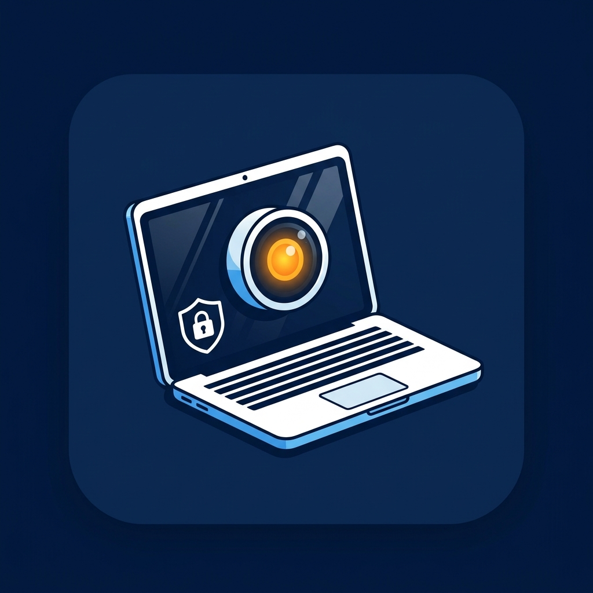
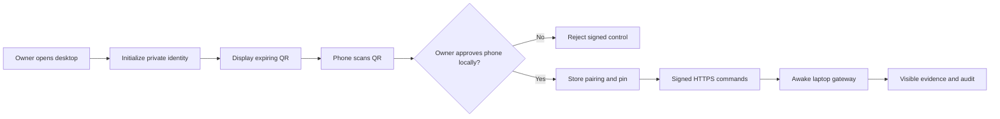
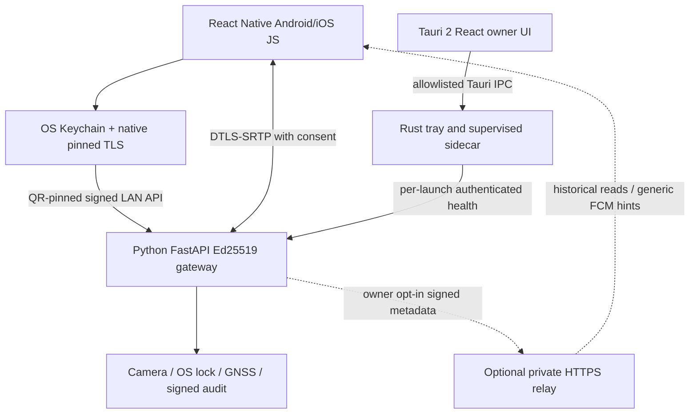

<div align="center">


# LaptopWatch

**A permission-first, owner-controlled laptop security companion**

React Native Android/iOS · Tauri + Rust desktop · Python signed gateway


</div>

> **Engineering checkpoint — NOT READY FOR RELEASE.**
> The owner authorized retiring the former Kotlin Compose app on
> **14 November 2026**. The overhaul has one canonical React Native mobile app,
> but neither its native builds nor cross-device security and performance have
> been certified. Do not sell or distribute this revision as a finished
> anti-theft product.

## What it does

LaptopWatch lets the person controlling a laptop explicitly pair their phone,
approve/revoke that phone on the laptop, and request signed actions while the
laptop is awake and reachable. Users can arm or disarm visible protection,
lock the OS, sound an alarm, send a spoken warning, request JPEG/MP4 evidence,
view encrypted WebRTC media and examine recorded incidents. The person
detector needs a separately installed, licensed, SHA-256-verified ONNX model;
it is not bundled or active by default.

Opt-in GNSS needs a **real gpsd-compatible receiver**; stored and remotely
retrieved fixes are clearly **LAST SEEN**, not guaranteed live tracking.
An optional owner-hosted HTTPS relay transfers encrypted event metadata and
can deliver Android FCM *hints*, never executable phone commands or proof of
an incident. Internet streaming/TURN needs additional infrastructure.

### Intended flow



### Component and trust boundaries



**Not a surveillance bypass:** pairing and capture require owner approval,
lawful notice, explicit controls and applicable operating-system permissions.
No PIN-in-URL fallback or fabricated biometric identification is part of the
new client. Power off, sleep, disconnected network, blocked hardware and
unprovisioned external services impose real limits.

## Implemented source and verification status

| Capability | Present in source | Not yet proven |
|---|---|---|
| Phone pairing, signed commands and private evidence | JS client, Android/iOS native bridges, Python signed API | Cross-platform device and attack testing |
| Desktop background supervision | Tauri tray, single instance, restart budget, HMAC-proven owner health | Installed OS restart, sleep and soak |
| Photo, recording, camera/WebRTC and opt-in audio | Python media adapter and RN viewer | Physical camera, codecs and end-to-end latency |
| Verified person incidents | Model-gated local guard and signed incident metadata | Licensed weights, accuracy and false positives |
| GNSS/recovery | Real gpsd last-seen history, opt-in signed encrypted relay | Receiver, network outage and field testing |
| Push/notifications | Android owner-gated FCM source + relay token rotation | Firebase provisioning, delivery and Doze |
| Private local storage | Keychain seed and OP-SQLite SQLCipher configuration | Native encryption, migrations and reinstall behavior |
| Commercial distribution | Proprietary source license; tested Paddle webhook/entitlement service (operator-enrolled devices; signed checkout tickets) | Client enforcement, self-service checkout, genuine locks, merchant approval, builds/signing/legal acceptance |

**Source implementation is not equivalent to a passing build.**
The original Kotlin app was retired at the owner's direction, not because
physical feature parity had been established. See
[the retirement decision](docs/KOTLIN_RETIREMENT.md),
[the parity matrix](docs/PARITY.md) and [the release gates](docs/STATUS.md).

## Technology stack

| Component | Technology |
|---|---|
| Shared phone UX | React Native 0.88, React 19, **JavaScript/JSX** |
| Android native adapters | Gradle, Kotlin, OkHttp, Android NsdManager, foreground service, optional Firebase |
| iOS native adapters | Xcode/Swift, URLSession leaf-certificate pinning, Keychain, share sheet |
| Mobile private data | React Native Keychain, OP-SQLite with SQLCipher option |
| Desktop UI | React, Vite, CSS, Tauri 2 |
| Desktop native process | Rust, Tauri shell/autostart/single instance, rusqlite |
| Laptop engine | Python 3.11+, FastAPI, Uvicorn, Pydantic |
| Cryptography | Ed25519 signed requests, nonce replay defense, TLS pinning, SHA-256, AES-GCM |
| Media/detection | OpenCV, PyAV, aiortc/WebRTC, sounddevice, optional owner-provided ONNX model |
| GNSS/discovery/relay | gpsd, Zeroconf, SQLite, FastAPI, Caddy, Docker Compose, opt-in FCM |
| Validation | pytest, Node test runner, Jest, Vitest, ESLint, JS check, Cargo, Gradle, Xcode |

## Repository layout

```text
mobile/
  src/          Shared JavaScript/JSX owner app, signed APIs, privacy
  android/      ONLY maintained Android native application
  ios/          ONLY maintained iOS native application
desktop/
  src-ui/       White-paper React/Vite desktop experience
  src-tauri/    Rust native shell, tray, supervised sidecar
  src-python/   Python authenticated service, tests, capture and GNSS
services/location-relay/    Optional encrypted owner metadata service
services/billing/           Paddle webhooks, subscriptions, signed licenses (pilot only)
design/                     Shared paper/blue/yellow/gold design tokens
shared/protocol-vectors/    Cross-language signing fixtures
ops/source_preflight.py     Offline source-contract preflight
docs/                       Architecture, parity, threat model, release runbooks
```

The deleted Kotlin Compose app and root Gradle build remain recoverable from
Git history. Android **Kotlin native adapters inside the React Native app**
are still required; those are not the retired product. No additional branches
or GitHub Actions workflows are used.

## Development and verification

Start from a trusted full clone with the documented toolchains. Examples:

```bash
python ops/source_preflight.py
python design/generate.py --check

python -m pip install -e './desktop/src-python[test,media,discovery]'
python -m pytest -q desktop/src-python/tests

cd mobile
npm install          # first dependency resolution; review/commit lockfile
npm run test:protocol
npm run test:ui
npm run lint
npm run check:js
cd android
./gradlew assembleDebug test lint
```

Desktop builds need Rust/Tauri prerequisites and the packaged Python sidecar;
iOS requires macOS, Xcode and CocoaPods. Do not use `npm ci` until a reviewed
lockfile has actually been created and committed. Credentials, signing
identities, real hardware and live provider services are not included.

### Strict local verification launcher

The included standard-library runner reports **PASS**, **FAIL** or
**BLOCKED** without inventing output. Run it on a machine with the actual
checkout and compatible toolchains:

```bash
python ops/verify_release.py --mode source
python ops/verify_release.py --mode full --json verification-results.json
```

The full mode requires real reviewed dependency locks, Android SDK, Rust,
Xcode on macOS and still marks physical/security/commercial sign-off as
BLOCKED pending actual evidence. A source-only green result is never
production approval. This repository does not include GitHub Actions.

**Authoritative commands and stop-ship checklist:**
[build and release runbook](docs/RELEASE_RUNBOOK.md) ·
[release checklist](docs/RELEASE_CHECKLIST.md) ·
[security threat model](docs/THREAT_MODEL.md).

## Development and security policy

- Develop and commit on `perez`, open a PR to `main`, merge after review and
  fast-forward `perez` to the merged commit. No feature branches or CI
  workflows without a separate decision.
- Never commit identity files, Firebase configuration, signing keys, actual
  evidence, model weights or customer data. No unsafe certificate bypass,
  unauthenticated owner routes or automatic offline lock/alarm queue.
- User-mode software cannot protect a laptop while power is unavailable,
  impersonate real GPS/identity evidence, guarantee capture in sleep or
  provide independent theft-recovery hardware.
- Installer signing, package audits, physical acceptance, privacy/consent,
  commercial license and any store approvals are mandatory before sale.
  **The original source has a proprietary LICENSE, but the product EULA,
  third-party commercial rights and merchant acceptance need approval.**

See [scenarios](docs/SCENARIOS.md), [architecture](docs/ARCHITECTURE.md),
[status](docs/STATUS.md) and [commercial policy drafts](docs/commercial/).


### 16 November 2026 engineering update

Account closure now has a persisted merchant cancellation queue,
Paddle response confirmation and retry logic, and mobile/desktop
pending-cancellation feedback. This is source integration, not a certified
Paddle deployment or signed consumer build. The trusted commercial issuer
pin still requires approved release provisioning. **No production release
is authorized.** See `docs/STATUS.md` and `services/billing/README.md`.


### Additional reliability hardening (16 November 2026)

The recording lifecycle now preserves completed MP4s pending explicit
finalization; JPEG quota/write operations are serialized and partial failed
writes are discarded. The alarm reports actual playback process failure
instead of treating asynchronous thread creation as a successful deterrent.
Commercial account closure erases enrolled device signing keys and replay
nonces while retaining required financial cancellation records. Commercial
release preflight checks the same independently verified issuer key in the
desktop and mobile clients. These are source changes, not proof of a
successful native build or tested physical-device release.
