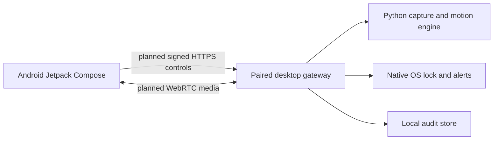

# LaptopWatch

**Android-controlled anti-theft monitoring for a user-owned laptop — under development.**

> **Release status:** NOT production ready, not approved for public Internet exposure, and not currently available in the app stores. This repository contains a functional Android prototype, a legacy companion generator, and migration work toward a secure desktop product. Read [defects](docs/DEFECTS.md) before testing.

LaptopWatch is designed to allow a user to arm a webcam, receive a motion/person alert, view the laptop camera, lock the workstation, sound an alarm, and use an intercom from an Android phone. Production versions will add a Windows/macOS/Linux desktop installer, per-device QR pairing and a private encrypted media connection.

## Present source vs. planned product

| Feature | Current source status |
|---|---|
| Kotlin / Jetpack Compose app with six screens | Implemented prototype; device behavior unverified |
| Setup, demo mode, Away Mode | Source exists; demo data is synthetic |
| Basic motion detection and screenshot | Legacy OpenCV daemon; no person-class verification |
| Laptop lock, siren, voice warning | Legacy Flask handlers; platform support must be tested |
| Local Room incident storage / export UI | Exists; migration and privacy testing pending |
| Foreground monitoring | Exists; Android 15+ timeout mitigation added on `perez` |
| Live GPS / recognized biometric subjects | **Not implemented on real hardware**; fake live server responses removed on `perez` |
| TLS validation | Trust-all override removed on `perez`; pairing-based pinning NOT integrated |
| Signed Ed25519 controls / replay defence | Tested standalone Python package; **not wired to legacy daemon/Android** |
| WebRTC full-duplex streaming / ICE handoff | **Not implemented** |
| mDNS discovery / TURN / relay | **Not implemented** |
| Tauri/React desktop app / installers | **Not implemented** |
| Legal/storefront/release readiness | Draft artifacts only, not submitted or approved |

## Security warning

The legacy laptop daemon is embedded in `app/src/main/java/com/example/util/LaptopCompanionScript.kt`. It uses a fixed PIN and HTTP, not a production-grade authorization system. On `perez`, the daemon binds to **127.0.0.1 by default**. Enabling `LAPTOPWATCH_UNSAFE_LEGACY_LAN=1` exposes the legacy control interface and is **only for isolated, trusted development labs**, never on public Wi-Fi or an Internet tunnel. The intended secure gateway is **not yet installed**. Never use this build to capture people without lawful consent.

The Android client no longer accepts any arbitrary TLS certificate. No insecure TLS bypass is acceptable even in the name of compatibility.

## Architecture



See [architecture decisions](docs/ARCHITECTURE.md), [baseline inventory](docs/MIGRATION_INVENTORY.md), [threat model](docs/THREAT_MODEL.md), [performance](docs/PERFORMANCE.md), and [device test matrix](docs/TEST_MATRIX.md).

## Development

**Android:** open repository in a matching Android Studio with the Android SDK and JDK/toolchain required by `app/build.gradle.kts`; resolve dependencies from `gradle/libs.versions.toml`. The existing tree lacks complete Gradle wrapper files; a clean-build reproducibility gate is not yet green. Do not assume `./gradlew` works until wrapper binaries/scripts are added and verified.

**Standalone Python auth/audit module (not a daemon):**

```sh
cd desktop/src-python
python -m pip install -e . pytest
python -m pytest -q
```

The unit suite tests Ed25519 signing, pair approval/revocation, durable replay protection, rate limiting and signed audit verification. It does not exercise Android, networking, a desktop UI, a live camera or any real laptop controls.

**Source layout:**

- `app/` — Android source (Compose UI, Room, ViewModel, OkHttp, legacy Flask generator).
- `desktop/src-python/` — secure companion primitives, tests; desktop integration pending.
- `docs/` — audit, defects, ADRs, threat model, test plan and release checklist.
- `docs/commercial/` — draft customer-facing and legal artifacts, not published policies.

## Branch and release policy

Exactly two branches: `perez` for all implementation work and `main` for known-good milestones. Every milestone is gated before a no-ff merge and annotated version tag. Do **not** merge code just because source files exist; see [release checklist](docs/RELEASE_CHECKLIST.md).

## Supported devices

**Target:** Android controller, Windows 11, macOS Intel/Apple Silicon, Ubuntu/Fedora. Support is not certified until measured on physical devices. Project `minSdk=24`, `targetSdk=36`; this is configuration, not a support guarantee.

## License

No author-approved distribution license has been committed. The old README's MIT claim was unsupported because there is no `LICENSE` file. Do not assume permission to redistribute, bundle or commercialize this source. Commercial terms and any public license must be approved by the rights holder before release.
