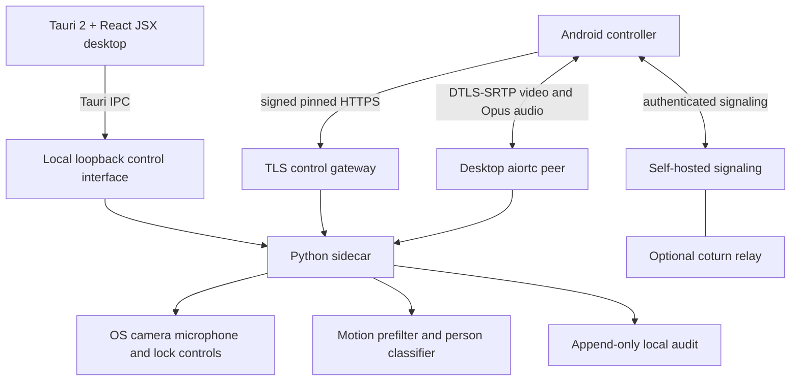

# LaptopWatch — architecture decision records

**Baseline:** 2026-09-20 `7a0c23d`. **Target product:** Android controller + Tauri desktop application + Python engine; opt-in WAN relay. These ADRs govern implementation, not evidence of completed features.

## System context

**Trust boundaries:** Android mobile device, user-owned desktop OS, local network, optional Internet signaling and TURN. The user must see and authorize camera/microphone capture. Pairing is explicitly approved on the laptop.

## ADR-001: WebRTC for real-time video and intercom — accepted / target

**Old:** GET JPEG snapshots, README-implied MJPEG and uploaded audio warnings. It cannot provide full-duplex, network migration, encryption and the requested latency guarantees in a complete media transport.

**New:** aiortc peer sends one video track and two-direction Opus audio tracks; Android uses a supported, maintained WebRTC SDK. WebRTC negotiates DTLS-SRTP, ICE and congestion control. Media exits via TURN only when direct candidate pairs fail. Keep REST for lock/alarm/status/config and still-frame emergency fallback, never for continuous media.

**Decision constraints:** negotiate H.264/VP8 according to device support; measure actual negotiated codec and encode path (avoid assuming aiortc automatically uses hardware acceleration). On capture set buffer size to one where the camera backend supports it, discard stale frames, explicitly release camera when disarmed. After 5s failed ICE negotiation, show labeled still-image fallback. Validate fallback security with pinned TLS, not anonymous HTTP.

**Acceptance:** frame-age instrumentation and §2.1 physical camera measurements. 24h duration and network handoff tests required before release.

## ADR-002: QR public-key pairing and signed control messages — accepted / target

**Old:** global four-digit PIN in app database, URL and server, server accessible on all interfaces.

**New:** each desktop generates an Ed25519 identity; each phone generates its own Ed25519 key in hardware-backed storage where available. Pair QR encodes `laptopwatch://pair?id=...&pk=...&sig=...` plus authenticated address/certificate fingerprint (if QR limits demand it, encode a signed compact payload with version). The laptop opens a short pairing window, displays a challenge, and requires desktop approval before pinning phone identity. Scanning is a user-mediated trust bootstrap, not PKI or a magical trust claim.

**Request signing:** include protocol version, method, normalized path, SHA-256 body digest, UTC timestamp, 128-bit unique nonce, device identity and signature. Canonicalization is byte-for-byte specified and tested in both languages. Verify the paired key, body hash, timestamp drift (bounded), nonce uniqueness and resource/action scope before processing. Pairing endpoint is rate-limited; revoked keys are denied. TLS certificate pinning remains mandatory for REST controls and snapshot fallback. Rotate certificates via an authenticated signed update or explicit re-pairing, never silent bypass.

**Acceptance:** wrong-key, replay, body modification, TLS MITM, expired/revoked key, clock skew, downgrade and concurrent nonce collision tests. No PIN or token in URL, logs, screenshots or backups.

## ADR-003: mDNS + ICE candidate selection — accepted / target

**Old:** manual IP entry, arbitrary LAN-first probes and optional user-entered tunnel.

**New:** desktop advertises `_laptopwatch._tcp.local` (id, version, name, fingerprint); Android uses `NsdManager`. After pairing, ICE prefers reachable host candidates, then STUN server reflexive peer-to-peer, then opt-in TURN relay. Report observed selected candidate-pair class as Direct LAN, P2P WAN or Relay WAN. Never infer WAN/LAN solely from IP ranges. Network callback triggers ICE restart and bounded connection recovery, then still fallback.

**Acceptance:** Wi-Fi 2.4/5GHz, mobile CGNAT, symmetric NAT, Wi-Fi→cellular handoff; 2s ICE restart recovery measured.

## ADR-004: Tauri 2 desktop + React JSX + packaged Python sidecar — accepted / target

**Old:** installation via generated batch and Flask daemon embedded in Kotlin source, no desktop app, no tray or settings UI.

**New:** `desktop/src-ui` React/Vite frontend, `desktop/src-tauri` Tauri 2 native shell and `desktop/src-python` Python package/sidecar. Build Python into architecture-matched executable **before** Tauri packaging, declare it under `bundle.externalBin` and spawn/terminate via constrained native commands. Desktop UI uses Tauri IPC only. Sidecar internal management listens on loopback with randomized port or a protected IPC socket. Public pair/control listener is separately configured and authenticated. Tray service and launch-on-login require user opt-in, with obvious camera status and Stop/Unpair actions.

**Risk:** on Ubuntu 24.04 WebKitGTK, verify JSX live-preview WebRTC early on physical hardware. Python-to-Android media does not rely on WebKitGTK; desktop self-preview might. If tested preview is blocked and no reliable workaround exists, Linux-only alternate packaging can be considered and documented. No fabricated test outcome.

**Reference:** https://v2.tauri.app/develop/sidecar/

## ADR-005: Person detection after cheap motion pre-filter — accepted / target

**Old:** frame differencing treats any significant change as intrusion.

**New:** lightweight frame difference only schedules an on-device MobileNet-SSD or small YOLO person classifier. Only person-class detection above configurable, measured threshold produces user alert. Keep raw motion metadata for diagnostics with retention bounds. Evaluate model licensing and download integrity before bundling. Do not claim every person is uniquely identifiable; do not add biometric recognition without consent and explicit separate scope.

**Acceptance:** seven-scene matrix with ground truth, precision/recall and false positives measured on CPU-only budget laptop, IR/night documented separately.

## ADR-006: Branch and release governance — accepted

Only `perez` (integration) and `main` (release). Every code commit lands on `perez`. Each of eight releases `v0.1.0` through `v1.0.0` uses a gated **no-fast-forward** merge into `main`, annotated tag and provenance. Never direct-commit to main, force push, invent a test result or merge a failed gate. Heavy commits by subsystem, not one-per-file. `main` must always be a tested release checkpoint.

Release boundaries:
1. v0.1.0 baseline audit/ADRs/threat model
2. v0.2.0 WebRTC, key pairing, mDNS/ICE and signaling
3. v0.3.0 desktop app and sidecar
4. v0.4.0 person detection
5. v0.5.0 platform packaging and licensing
6. v0.6.0 onboarding/accessibility/polish
7. v0.7.0 quantified performance and soak
8. v1.0.0 commercial legal/store artifacts and real submissions

**Note:** a GitHub file edit or documentation existence does not meet a binary, signing or physical device gate. Version tags are created only after all checks and required signatures are performed. To verify Mermaid in Markdown, extract fenced mermaid blocks into individual `.mmd` files and run `mmdc -i diagram.mmd -o diagram.svg`; passing the complete Markdown file as a Mermaid graph is not a valid CLI input.

## Known design conflicts requiring careful implementation

- `127.0.0.1` binds only for sidecar management, **not** for directly discoverable LAN control. A separate TLS/mTLS gateway is required for paired network clients.
- A private Ed25519 signing key cannot double as the DTLS certificate without correct conversion. Separate identities, authenticated binding and rotation policy are needed.
- Direct LAN can be HTTP only for an initial *explicitly insecure and developer-only* compatibility mode; production camera and controls require authenticated encrypted transport.
- Android 15+ limits `dataSync` foreground service time to six hours per 24 hours in the background. Rework continuous monitoring and notifications; do not rename foreground service type just to evade platform policy: https://developer.android.com/develop/background-work/services/fgs/timeout
- Client-only zero-cloud marketing must be reevaluated if relay, signaling, payments, licensing, push, or analytics providers are deployed. Data flow statements must match actual deployments.
- Current Android `minSdk=24` disagrees with README Android 8+ claim. Choose an explicitly tested minimum, not only a badge.
