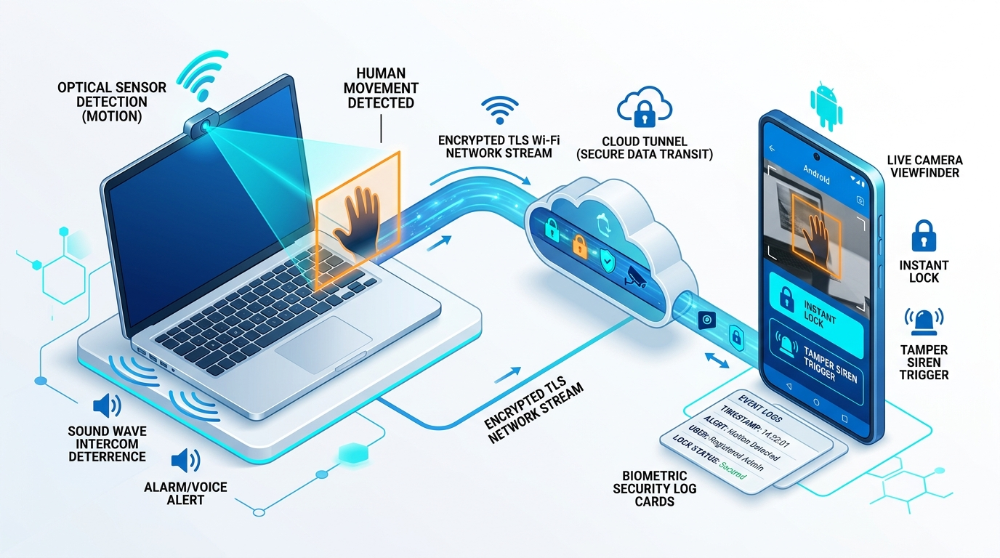
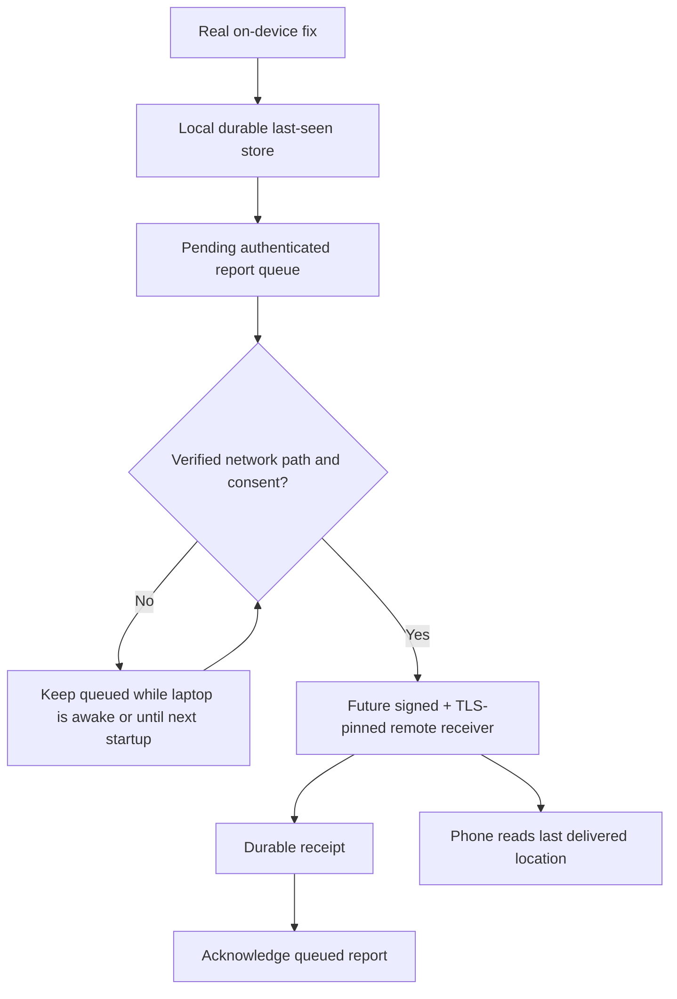

# LaptopWatch — accurate location, offline last-seen and theft recovery

**Status:** Python GNSS plus source-level signed remote relay/uploader and Android retrieval; **not a verified theft-recovery service until deployed and field-tested**.

## Reality vs goal

The requested ideal is precise GPS even after a laptop is stolen, continuous operation through sleep and no Internet, and immediate reporting when connectivity briefly returns. **No ordinary program can guarantee all four**. GPS requires a real positioning source, connectivity requires a supported network state, a powered-off computer cannot execute user-mode code, and locally queued data is not remotely viewable unless delivered.

### Location sources, sorted by trust

| Source | Available | Precision | Constraints |
|---|---|---|---|
| Dedicated GNSS/GPS receiver (USB/internal, via `gpsd`) | **Python adapter implemented** | Reports receiver's actual horizontal uncertainty; depends on satellite view | Must be attached and running; indoors often unreliable |
| Native OS location services (Windows/macOS/Linux GeoClue) | Not implemented in new companion | Depends on Wi-Fi/other providers, not universally GPS | App permission, OS privacy controls and platform APIs |
| Wi-Fi positioning service | Not implemented | May be coarse, indoor improvement possible | External location provider, keys, fees, explicit consent |
| Geolocation by IP address | Not implemented on purpose | Often city/ISP level, not device GPS | Never label it a precise location |
| Phone's own GPS | Existing Android location API dependency, but **not the laptop's position** | Phone location only | Cannot track a stolen laptop by assuming its position equals the phone |
| Apple's Find My (compatible Macs) | Separate Apple feature | Hardware/OS/network dependent | May work offline and asleep with Find My network enabled |
| Microsoft's Find My Device | Separate Windows feature | OS location availability | Must be configured before loss; network/platform conditions apply |
| Dedicated battery-backed GNSS + cellular tracker | External hardware, not part of repo | True independent tracking when laptop is off | Recurring connectivity and hardware cost |

## Python implementation

`desktop/src-python/laptopwatch/tracking.py` contains:

1. `GpsdReceiver` — opt-in loopback-only `gpsd` TPV source; requires an actual 2D/3D fix and valid recent receiver time, latitude/longitude, and error estimates `epx` and `epy`. No receiver => no data. A GNSS fix with no accuracy estimate is not accepted.
2. `LocationFix.validate` — rejects invalid coordinate ranges, NaN/infinite numbers, unknown accuracy, fake provider labels and stale/future timestamps.
3. `LastSeenStore` — durable SQLite history with exact `observed_at_ms` timestamp, `accuracy_meters`, and an `is_recent_fix` age indicator (up to two minutes). Stored last-seen records always report `is_live_fix=false`; only a successful immediate receiver refresh may be marked live, and it must have been observed within 30 seconds. On Unix, database file permissions are restricted to the current user; use full-disk encryption.
4. `TrackingService` — explicit `refresh()`, pending queue of unsent records, and `on_secure_transport_available(sender)`, which **only acknowledges an event after a trusted sender confirms remote durable receipt**. No sender is automatically deployed.
5. `LocationPoller` — opt-in periodic sampling, default 30 seconds, **only while the process is running**; stopped at service shutdown.

The CLI `serve --enable-gpsd` explicitly enables provider sampling. The gateway exposes **signed** `GET /api/location/last-seen` and `POST /api/location/refresh`. With no configured real provider or valid fix, the API reports unavailable instead of fabricated location. Last-seen values become stale with age even if no new data arrives.

## Remote reconstruction after theft — not yet implemented

The following systems are **required** before stolen-laptop retrieval can be claimed:

- Authenticated and end-to-end private remote location sink/relay (hosted by customer or product), reachable whenever the awake laptop is online.
- Desktop startup/session integration, NetworkChange and Resume hooks to trigger immediate retry and refresh; backoff and heartbeat when online (subject to OS restrictions).
- Delivery confirmation semantics, expiry/retention, explicit owner account access, device revoke and consent revocation with deletion.
- Pinned TLS, signed reports, server-side timestamping, anti-replay and encrypted storage in the trusted location service.
- Android phone native pairing, background push, correct display of freshness, accuracy and signal source. "Last seen" must refer to the latest **remote-received** record, not only the unreadable local database on a stolen laptop.
- Native Windows/macOS privacy-consented location sources for devices without GNSS; never invent one-meter precision. Real hardware and cross-platform sleep/wake testing.

**Brief Internet reconnect:** The local queue is implemented; **instant remote ping is not**. Once trusted delivery is integrated, a network event may schedule a send promptly while the laptop runs, but short or captive connections may still fail. Report successful receipt and original measurement timestamp separately.

## Sleep, lid closed, stolen device

- If the laptop enters normal system sleep, Python code and most processes are suspended; webcam capture cannot be guaranteed. Windows Modern Standby provides tightly restricted OS-mediated background networking, not general indefinite Python daemon execution.
- Apple documents offline locating for supported sleeping Macs via its Find My network, which is separate from LaptopWatch and uses other Apple devices to relay location. LaptopWatch cannot silently access Find My location data.
- For Windows, enable Microsoft account Find My Device and system location before theft; availability is subject to Windows service and networking.
- If the laptop loses power or storage is wiped, only **previously remotely delivered** records remain accessible. For guaranteed independence from the laptop, buy independent battery-powered GPS/cellular hardware.

Official documentation:
- https://support.apple.com/guide/security/find-my-security-sec6cbc80fd0/web
- https://support.apple.com/guide/findmy-mac/set-up-fmm53101237/mac
- https://support.microsoft.com/en-au/accounts-billing/security/find-and-lock-a-lost-windows-device
- https://learn.microsoft.com/windows-hardware/design/device-experiences/modern-standby-network-connectivity

## Privacy, encryption and consent

Location of a person or device can be highly sensitive. Require explicit opt-in on the locally owned laptop, show an active tracking indicator, allow Stop/Delete, do not upload photos/audio/location without clear consent, and do not use this system to track someone else's device. SQLite permissions alone do not replace full-disk encryption. Key and trusted remote-receiver design must be completed before WAN sync is enabled.

## Verification evidence

- Tested locally on Python with mocked GNSS receiver, SQLite restart, stale-fix checks and offline queue replay; **not hardware-GPS accuracy measurement**.
- No receiver/OS permission tests, no actual WAN relay service, no phone integration, no sleep-resume/device-wipe testing, no mobile user interface for tracking.
- Release gate: real fix accuracy comparison with reference GNSS at outdoor/indoor positions, cold/warm fix latency, network outages, power-state matrix and server receipt replay testing.

See [SCENARIOS.md](SCENARIOS.md) and [RELEASE_CHECKLIST.md](RELEASE_CHECKLIST.md).
