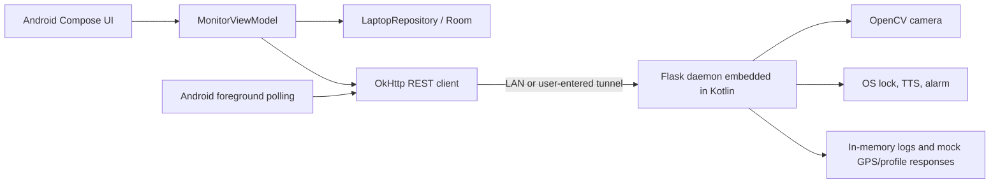
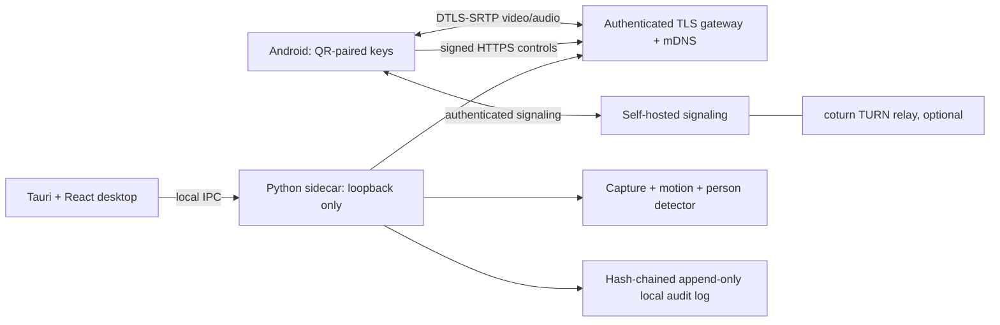

# LaptopWatch — migration and source inventory

**Baseline:** `main` and `perez` at `7a0c23d169d74b06241db95689c267eae8a13378` (2026-09-20).  
**Audit date:** 2026-11-13.  
**Status:** source-inspection baseline, not a tested release.  
**Brand:** LaptopWatch. Legacy strings "Laptop Sentinel", "Laptop Security Guard" and "laptop monitor" are to be migrated consistently.

## Actual repository surfaces

| Surface | Present | Files / state | Migration destination |
|---|---|---|---|
| Android UI | Yes | `MainActivity.kt`, six Compose screens, theme, component tree | Android LaptopWatch application |
| App state | Yes | `LaptopMonitorViewModel.kt` (1,427 lines) | Split domain/use cases from UI state |
| REST client | Yes | `network/LaptopApiClient.kt` | Signed, pinned HTTPS control client; WebRTC media |
| Background polling | Yes | `service/LaptopMonitorService.kt` | Policy-compatible session/alert lifecycle and push |
| Persistence | Yes | `data/AppDatabase.kt`, Room v6, four entities and DAOs | Explicit migrations and tamper-evident event store |
| Python laptop service | Embedded only | `util/LaptopCompanionScript.kt` stores installer and complete Flask script | `desktop/src-python/laptopwatch/` maintained as real Python package |
| Vision | Primitive | `motion_detection_worker` frame-difference | Motion pre-filter + validated person detection |
| Streaming | Incomplete | JPEG frame route; README claims MJPEG route not present in daemon | aiortc WebRTC video and Opus audio; still-frame fallback |
| Host monitoring | Present | Flask status, lock, warning, alarm, camera snapshots and record endpoints | Hardened, authenticated, bounded control API |
| GPS | Mock | Fixed San Francisco coordinate and constant 1m claim in Python; demo values in Android | Distinguish sensor data, coarse estimate, and no fix; never synthetic data in live mode |
| Biometrics | Mock | Fixed subject profiles and confidence emitted by server | Remove live claims until real opt-in classifier is built |
| mDNS / ICE / TURN | No | No discovery, ICE or signaling implementation in repository | Android NsdManager, aiortc, self-hosted signaling and coturn |
| Desktop shell | No | No Tauri/React/Rust project | Tauri 2 + JSX frontend and managed Python sidecar |
| Android tests | Minimal | ExampleUnitTest, Robolectric example, screenshot test, instrumented example | Unit + instrumentation + E2E + adversarial suite |
| Python tests | No | No real Python package or pytest | pytest suite with fixtures and transport/security contract tests |
| Build wrappers | Incomplete | `gradle/wrapper/gradle-wrapper.properties` exists, wrapper scripts and JAR absent | Reproducible Gradle wrapper and signed artifacts |
| Store/legal | No | No LICENSE, EULA, privacy policy or site | Commercial artifacts with legal/business review |
| CI | No | No workflow files | Milestone local gates; CI only if explicitly enabled later |
| Signing keys/certs | No | No real signing credentials; template secrets file | Generate outside VCS, managed secret store |
| Git branches | Two | `main`, `perez`; same SHA | Preserve only these branches |

## Android screens in main

1. Alerts dashboard — motion status, away mode, alarms, lock actions.
2. Webcam — live/snapshot view and recording controls.
3. Location tracker — osmdroid maps, geofence and history UI; live hardware verification absent.
4. Intruder logs — local event history and subject profiles.
5. Voice intercom — prerecorded audio upload and voice UI, not proven full-duplex WebRTC.
6. Setup — connection modes, IP/URL/PIN, embedded companion installer sharing.

## Observed runtime flow (as-is)

Current limitations: user enters IP and PIN; `LaptopApiClient` disables TLS validation; camera and controls share PIN auth; no TURN, no WebRTC, no real desktop installer; false-positive detector uses frame-difference only.

## New target flow

Important: the user-facing LAN gateway is a separate explicitly enabled listener; local sidecar management stays bound to loopback. Signaling and TURN are optional remote infrastructure, not a default video datastore.

## Compatibility and migration

- Existing Room v6 may contain incidents; **do not** use destructive migration for production. Write incremental migrations, export old events before switching models, test upgrade from schema v6.
- Legacy `pin` query parameters must not be supported by the public gateway after authenticated rollout. One opt-in localhost-only migration path may exist temporarily and must be loudly marked insecure.
- Live location and face labels must show "Unavailable" rather than fabricated fixes.
- Existing demo scenarios remain available only in explicit Demo Mode, with demo watermark and separate sample records.
- Existing `main` remains untouched until a milestone's build, test and evidence gates pass.
- Vendor hardware and signing requirements are outside source-only verification; never mark those gates green on inference.

## Baseline change trail

- 2026-09-15: initial project + Compose configuration.
- 2026-09-15: UI / config refactor.
- 2026-09-16: service, wake lock and certificate-bypass networking introduced.
- 2026-09-17: haptic feedback.
- 2026-09-18: edge-to-edge status header adjustment.
- 2026-09-20: GPS UI and dark theme integration.

## Required verification environments

Android 12–current: Pixel, Samsung and budget 3GB RAM device; desktop: Windows 11, macOS Intel + ARM, Ubuntu 24.04 X11/Wayland, Fedora; networks: LAN 2.4/5 GHz, CGNAT, symmetric NAT, Wi-Fi/cellular handoff. Use `docs/TEST_MATRIX.md` and `docs/PERFORMANCE.md`; no simulated numbers accepted as measured results.
