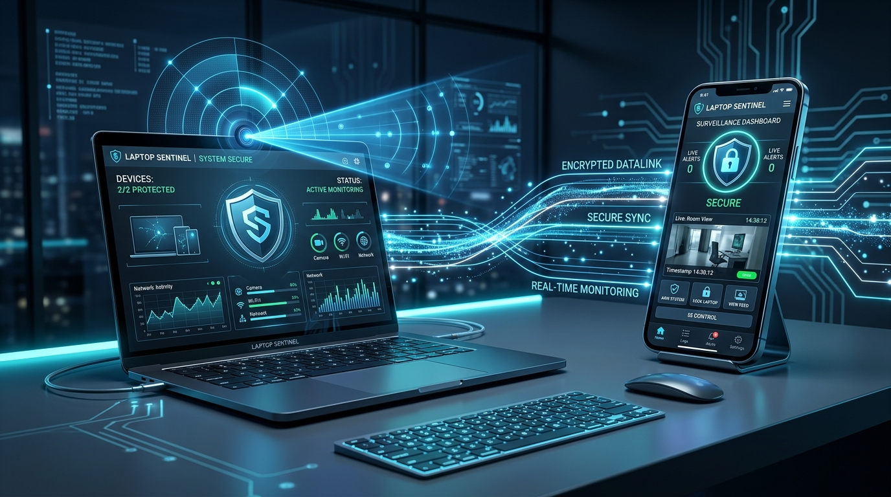
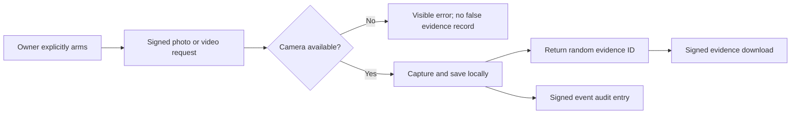
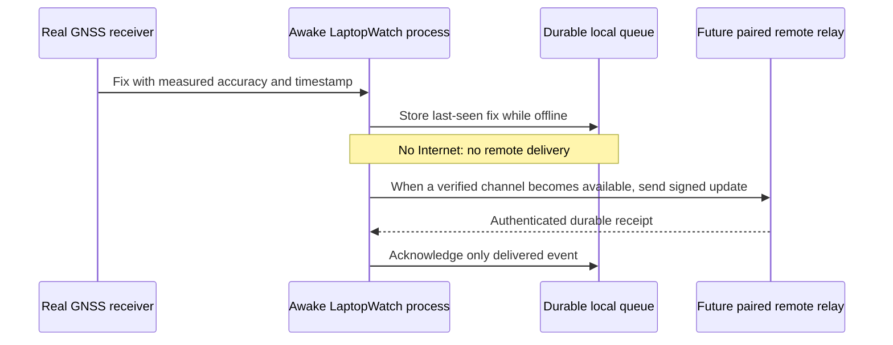

# LaptopWatch — café, restroom, incident and stolen-device scenarios

> **Status:** These are acceptance scenarios and honest current behavior, not demonstrations of a finished Android ↔ desktop pairing product. Recording others can be illegal without notice/consent. The camera must visibly operate and never bypass hardware privacy indicators.

## Scenario A — I go from a café table to the restroom

**Conditions:** My own laptop is open, safely placed, powered and not asleep. The desktop app is installed, the Android phone is correctly paired, the camera view is unobstructed and recording is permitted at the venue. In the *shipping target*, the phone and laptop find each other without asking me to type an IP or global PIN.

1. At my table I lock the laptop screen, open LaptopWatch, and deliberately arm camera-based security. The UI confirms what is recording and shows a visible camera indicator.
2. I take my phone to the restroom for a few minutes; local camera capture and a person classifier stay active on the laptop **only while the machine is awake and the app runs**.
3. Someone walks toward my desk. Real motion activates the low-cost pre-filter; the on-device person detector should trigger a phone alert instead of treating curtains, pets, flickering monitors or changing light as an intruder.
4. I can choose to open encrypted live video, **take a photo** (private JPEG evidence) or **start/stop recording** (local MP4 clip) from the paired phone. Captures are time-stamped, retained per policy, and clearly displayed as running.
5. I can lock the laptop screen remotely or optionally sound an alarm. I do not remotely unlock it; OS authentication stays on the laptop.
6. I return, stop recording, disarm surveillance and review or delete my evidence. The webcam is released, hardware privacy indicator turns off and session audit records remain available.

**Implementation today:** The new Android ↔ desktop QR signing, manual photos, MP4 and WebRTC controls are connected at source level, **but have not passed hardware builds or end-to-end field tests**. The new signed Python gateway separately supports lock, alarm, JPEG photo, bounded MP4 start/stop and authenticated evidence download. Its native camera behavior still needs physical-device testing.

**Critical caveat:** If the laptop lid is closed so the webcam points at a blocked scene, it cannot watch the room. If the OS sleeps, ordinary Python camera detection and network requests stop. Never recommend disabling all sleep protections on a laptop in a bag; that is a thermal and safety hazard.

## Scenario B — I need a quick photo or clip

**Photo:** client signs `POST /api/camera/photo`. Gateway rejects an unpaired key, replayed nonce and disarmed session. Webcam produces a JPEG; it is stored under `evidence/photo-<randomid>.jpg` and camera hardware is released unless an active recording is using the same capture device.

**Video:** client signs `POST /api/camera/record/start` and later `POST /api/camera/record/stop`. The webcam is held during recording, MP4 frames are written to a private local `video-<randomid>.mp4` and stop finalizes and releases the camera. Clip duration is capped, and failure returns an error. **No audio track is captured by this video recorder**. A production build needs persistent user-visible recording state, local free-space/retention controls, codec tests, crashes/partial-video recovery and consent UX.

**Recovery/download:** only the paired signing identity can call `GET /api/evidence/photo/<id>` or `/api/evidence/video/<id>` over trusted TLS. A REST filename never authorizes an arbitrary path. The Android app is not wired to these endpoints yet.

**Acceptance tests:** photo saves readable JPG, camera releases on error, video file has decodable frames and coherent FPS/duration, recording honors arm/disarm, OS camera permission is respected, and no unauthorized clients can download evidence.

## Scenario C — my laptop is grabbed while I am away

An alarm may draw attention but cannot physically stop theft. A thief may shut the lid, disable Wi-Fi, turn off the machine or remove the storage. Camera evidence left only on the stolen machine may be lost. To improve recovery, the *planned* privacy-consented deployment should synchronize small, authenticated event/location proofs to a trusted remote account **before** disconnection, without silently uploading raw video.

My phone can display the **last independently received location** and its original timestamp/accuracy. It must never show the laptop's last known coordinate as "live" when the source was last seen hours earlier.

Enable the operating system's own recovery options ahead of time: Apple's Find My on compatible Macs and Windows Find My Device on eligible Windows systems. These are separate from LaptopWatch and have their own coverage and hardware requirements.

## Scenario D — Internet gets cut, then briefly returns

**Implemented:** a local GNSS provider adapter, persistent SQLite fixes, and a queue whose `on_secure_transport_available(sender)` hook retries without losing records on failure. **Implemented at source level:** an opt-in signed desktop uploader and one-owner HTTPS relay with AES-GCM encrypted location records and an owner-phone retrieval API. **Not completed:** deployment, actual connectivity telemetry, push notifications, phone credential provisioning tests and OS resume/reconnect event wiring. Therefore an Internet connection that lasts only milliseconds is **not** guaranteed to deliver a location. A stale fix may be the only useful information.

**Acceptance tests:** restart with no network preserves queue; failed or unauthenticated receipt never acknowledges; a valid receipt removes exactly the delivered record; queue remains ordered; privacy consent can disable collection and purge history; no location is invented when a receiver is absent.

## Scenario E — laptop sleeps, loses battery or is off

**Deep sleep / shutdown:** user-mode webcam, Python and GPS polling do not run. Modern Standby on some Windows devices may retain limited OS-managed network access, but LaptopWatch must not claim unrestricted background execution. Some Macs can be located through the Apple Find My offline network even while asleep, which is an Apple platform feature—not LaptopWatch Python processing.

**Accurate tracking without laptop power:** requires independent battery-powered radio and position capability (for example a cellular GNSS tracker). A service install, wake timer or magic packet does not supply independent power or Internet.

## Explicit test matrix

| Scenario | Success definition | Current evidence |
|---|---|---|
| Café arming and phone alert | User pairs, arms, walks away, receives verified person alert | Not run; Android pairing/model absent |
| Photo | Authenticated capture produces readable JPG; permission enforced | Python mocked unit test passed; hardware pending |
| Video | Signed start/stop produces playable MP4, camera released | Python mocked unit test passed; hardware pending |
| Offline GNSS last-seen | Real fix survives restart, stale clearly labeled | Python tests passed |
| Brief connectivity | Trusted remote receipt updates phone | No remote system integrated |
| Closed lid | No false claim of visibility or continued capture | Documented, physical test pending |
| Sleep / powered off | No false "live GPS" readings | Designed to fail honestly, hardware test pending |
| Theft alert | Owner receives evidence even if disk later removed | Requires encrypted remote evidence transport |

Related: [README](../README.md) · [Location and Recovery](LOCATION_AND_RECOVERY.md) · [Performance Evidence](PERFORMANCE.md) · [Release Checklist](RELEASE_CHECKLIST.md).
