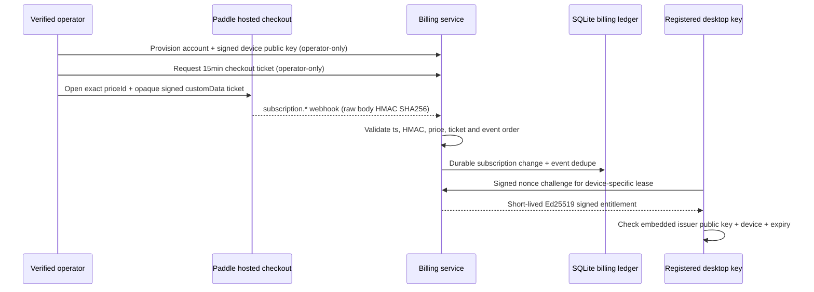

# LaptopWatch commercial subscriptions — source integration

**Status: local billing code and contract tests only. NOT live merchant checkout,
NOT a signed customer build, NOT a verified production service.**

Uses Paddle Billing as the proposed Merchant of Record. No card data, email
address or customer portal bearer URLs are stored locally. Paddle merchant
eligibility (particularly security/anti-theft software) and the actual seller,
prices, plan rights, refunds, taxes, payouts, mobile store policies, and legal
terms require owner approval. **Never activate without commercial approval.**

## Trust flow

A **verified `subscription.*` event plus a matching verified
`transaction.completed` payment event** is required to grant a paid
entitlement. A checkout success callback or uncollected invoice does not
authorize access. Verified `adjustment.created/updated` refund and
chargeback events place a conservative entitlement hold pending manual
reconciliation. The service denies leases for past_due, canceled, paused,
expired, refunded/held, revoked, unregistered or over-quota identities;
unrecognized prices are rejected. Out-of-order webhook events cannot
reactivate a canceled subscription. Missing information is fail-closed.

## Setup on a trusted host

1. Obtain **written Paddle approval** for the product category and operating
   jurisdiction, then provision *sandbox* products/prices and a webhook
   notification destination. Final approval and production API keys are not
   supplied by this repository.
2. Set environment values from `.env.example` using a secret manager. Enforce
   TLS 1.2+ at a trusted proxy, accept webhook POSTs only at `/webhooks/paddle`,
   rate-limit and network-restrict `/v1/admin/*`; NEVER expose the operator
   bearer in a browser or mobile app.
3. Generate the Ed25519 issuer key offline and protect its private bytes:
   `python -c "from cryptography.hazmat.primitives.asymmetric.ed25519 import Ed25519PrivateKey; from cryptography.hazmat.primitives import serialization; k=Ed25519PrivateKey.generate(); print(k.private_bytes(serialization.Encoding.PEM,serialization.PrivateFormat.PKCS8,serialization.NoEncryption()).decode())"`
   Do **not** print that key on shared machines; deploy through secret storage.
   Embed the corresponding **public key** into trusted desktop builds after an
   independent review and require it when verifying offline leases. NEVER trust
   an unverified `public_key` returned alongside an API response.
4. `python -m pip install -e './services/billing[test]'`
5. `python -m pytest -q services/billing/tests`
6. `laptopwatch-billing` starts the server on **127.0.0.1:8899**. Use a
   properly secured TLS reverse proxy for public webhook and lease traffic.
7. Operator provisions `POST /v1/admin/accounts`, `POST /v1/admin/devices`,
   `POST /v1/admin/checkout-ticket`; provide approved `price_id` and checkout
   ticket to the Paddle.js `Checkout.open({items:[{priceId,quantity:1}],customData})`
   **only after operator-authenticated provisioning**. See Paddle's official
   Checkout docs. Operator provisioning is intentionally NOT public signup.
8. Configure the Paddle notification destination to deliver
   `subscription.*`, `transaction.completed`, `adjustment.created`, and
   `adjustment.updated` event families. Neither a subscription event without
   a recorded completed payment nor a checkout success screen grants access.
   On signed Paddle subscription creation, the first webhook must include
   `custom_data.laptopwatch_checkout_ticket`. It is copied to subscriptions
   for recurring prices. Events without a valid ticket or pre-existing account
   binding return 422 and require manual reconciliation. Once a subscription
   has been bound, updates use the persisted account/merchant customer ID.
9. Registered desktop signs challenge bytes exactly:
   `LW-LICENSE-1\n{account_uuid}\n{device_uuid}\n{unix_seconds}\n{nonce_b64url16}\n`
   POST that body and base64url signature to `/v1/licenses/lease`. Verify the
   Ed25519 signed lease using the **pinned** issuer public key, local desktop
   identity, plan, and expiration. Maximum lease TTL is 1 hour.
10. For billing management, sign the distinct `LW-PORTAL-1\n...` challenge and
    call `/v1/billing/portal`. It creates a fresh provider-hosted session for
    the bound customer; do not store/cache/log the returned URL. Use Paddle's
    hosted portal to manage subscription, cancellation, invoices and payment
    method. The provider callback is **not** license authority: webhook is.

The license-issuer service does **not** create a full customer login, email
verification, purchase UI, mobile-app in-app purchases, automated device
self-enrollment or recovery workflow. Until those exist, operator actions
are mandatory: **this is a secure pilot billing backend, not customer-ready
self-service commerce**. No code in current desktop/mobile apps enforces
paid entitlements yet. Integration, issuer key pinning, recovery and merchant
approval remain release blockers.

## Operational requirements

- Store SQLite in a dedicated private encrypted host volume, enforce single
  writer or migrate to transactional Postgres before multiple replicas.
- Back up database plus encryption materials securely; run restore drills.
- Use separate sandbox and production secrets, keys, prices, URLs and data.
- Reconcile missing/failed webhook deliveries against Paddle's API before
  claiming customer access or billing correctness; monitor 422 responses.
- A trialing subscription also requires a verified completed transaction
  under the current conservative policy; an actual free-trial product
  requires a separately tested and approved entitlement rule. Past_due
  fails closed with no automatic grace.
- Current configured plans: Pro=3 devices, Business=10. No unlimited devices;
  actual plan prices/quotas are owner-controlled and NOT yet approved.
- Store only merchant subscription/customer IDs, plan, status, period and
  signed device public keys. Do not collect payment-card details.
- Approved/pending refund and chargeback notifications conservatively
  suspend new leases, even for partial adjustments, until an operator
  reconciles the situation. Automated reinstatement, proration,
  transaction-per-renewal reconciliation and fraud workflows remain
  unimplemented; review actual Paddle semantics before live billing.
- Key rotation, self-serve identity onboarding, device activation and
  cross-platform client enforcement remain incomplete; document them before launch.

Paddle references: https://developer.paddle.com/webhooks/about/signature-verification/,
https://developer.paddle.com/webhooks/subscriptions/subscription-updated/,
https://developer.paddle.com/api-reference/customer-portals/create-customer-portal-session/,
https://www.paddle.com/help/start/account-verification/which-countries-are-supported-by-paddle
